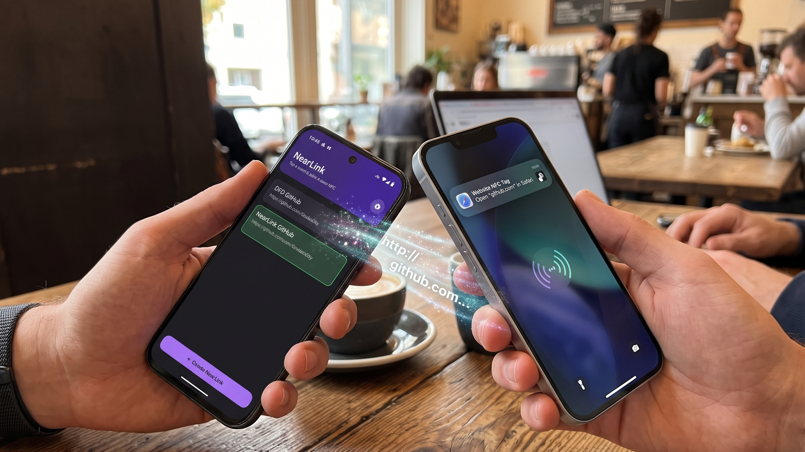
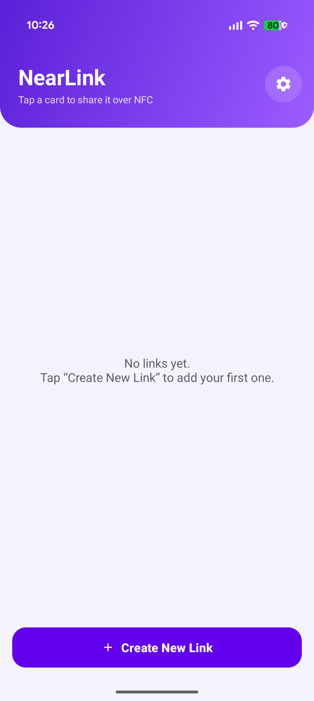
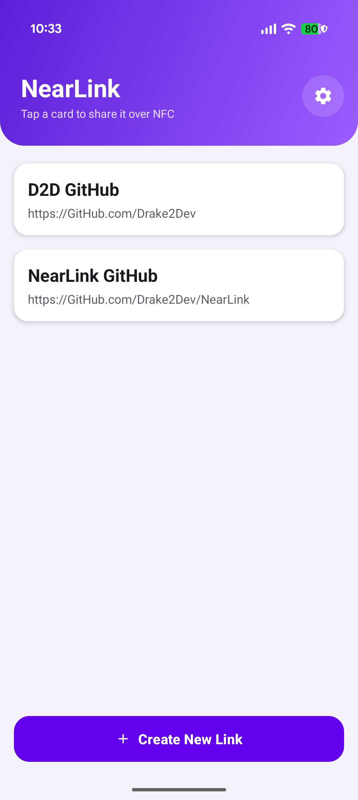
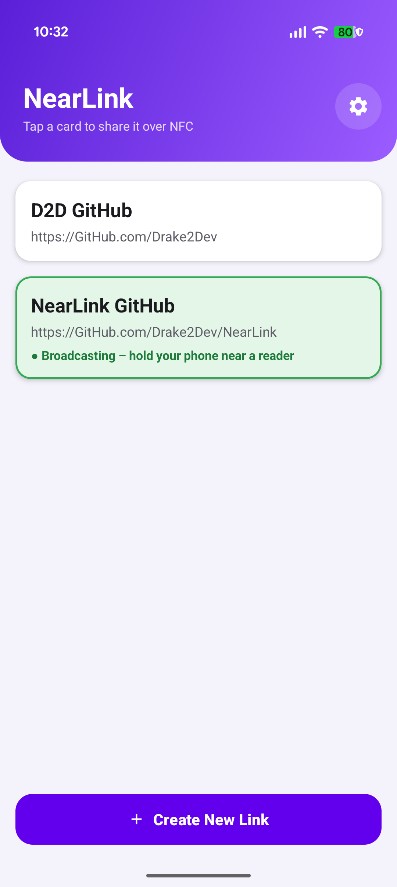
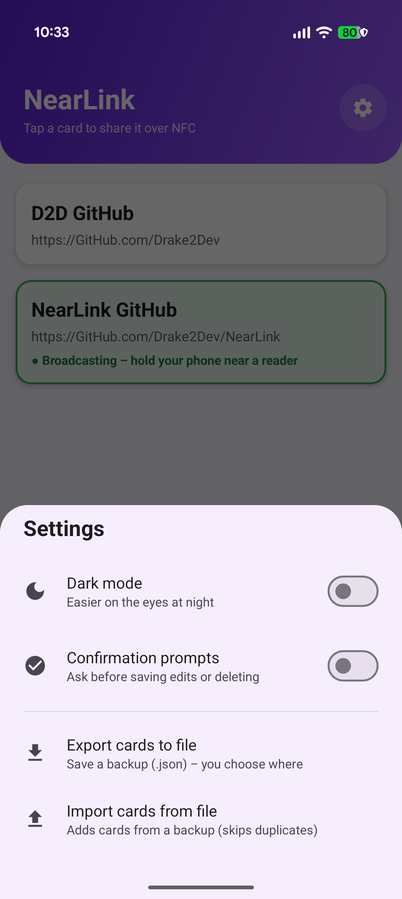
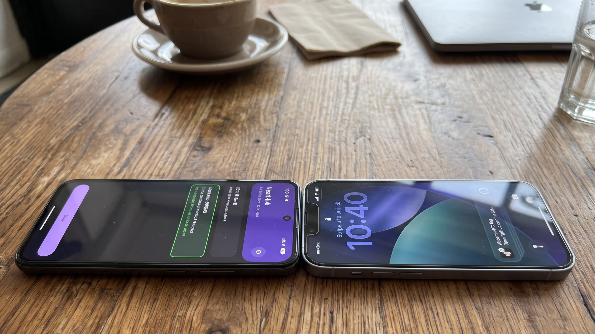

# 📡 NearLink
### The Dynamic NFC Digital Wallet for Android

Turn your Android phone into an instant tap-to-share digital business card and link broadcaster.

[**Download on Google Play**](https://play.google.com) *(Coming Soon)* • [**Privacy Policy**](PRIVACY.md) • [**Report Bug**](https://github.com/Drake2Dev/NearLink/issues)

 

---

## 📱 Interface & Screenshots

| Empty State | Saved Cards | Active Broadcast (Light) | Settings & Backup |
|:---:|:---:|:---:|:---:|
|  |  |  |  |

---

## 📖 Overview

**NearLink** transforms your Android smartphone into an on-demand, customizable NFC tag using **Host Card Emulation (HCE)**. Whether you are networking at a conference, pitching a portfolio to a client, or exchanging social handles, NearLink lets you beam any URL directly to another NFC-compatible smartphone with a single tap.

Ditch stacks of paper business cards, separate hardware tag programmers, or static physical tags. NearLink brings dynamic, switchable NFC link broadcasting right into your pocket.

---

## ✨ Features

- 🗂️ **Digital Card Wallet:** Organize personal links, social profiles, business cards, portfolios, or payment URLs into a clean, distraction-free card deck.
- ⚡ **One-Tap NFC Emulation:** Tap any card to activate NDEF broadcasting. The card illuminates with a green glow and status text to confirm you are live. Tap it again to stop broadcasting immediately.
- 🛠️ **Long-Press Card Actions:** Long-press any card to bring up dedicated **Edit** and **Delete** actions. Tap anywhere outside the card to exit action mode safely.
- 💾 **JSON Backup & Restore:** Export your entire card collection to a clean `.json` file using Android's native Storage Access Framework. Easily import it onto another device with automatic duplicate detection.
- 🛡️ **Optional Confirmation Safety:** Enable confirmation prompts in Settings to prevent accidental card deletions or edits.
- 🌓 **Light & Dark Theme:** Built-in theme selection tailored for comfortable viewing in both bright and low-light environments.
- 🔒 **100% Private & Offline:** Zero analytics, zero ad trackers, zero telemetry, and no account required. All data remains stored exclusively on your device's persistent local memory.

---

## 🚀 How to Use NearLink

### 1. Creating a Link Card
1. Open NearLink and tap **`+ Create New Link`** at the bottom of the screen.
2. Enter a descriptive **Card Name** (e.g., *Personal Website*, *LinkedIn*, *GitHub*).
3. Enter the target **URL** (e.g., `github.com/Drake2Dev`). *(If no scheme is provided, NearLink will automatically prepend `https://`)*.
4. Tap **Save**.

### 2. Broadcasting via NFC
1. Make sure **NFC** is turned **ON** in your Android device's system settings.
2. In NearLink, **tap the card** you want to transmit.
3. The card will turn green and display:  
   `● Broadcasting – hold your phone near a reader`
4. Hold the back of your phone near the NFC sweet spot of the recipient's smartphone or NFC reader.
5. Tap the card again at any time to **Stop Broadcasting**.

  
  
<i>Align the NFC sweet spots between the devices (typically top edge on iPhone, center or camera area on Android).</i>

### 3. Editing or Deleting Cards
1. **Long-press** the card you wish to modify.
2. The card elevates and reveals **Edit** and **Delete** buttons:
   - **Edit:** Opens the dialog to update the name or URL.
   - **Delete:** Removes the card from your list (with a confirmation modal if enabled in settings).
3. Tap anywhere outside the card or press the system back button to exit action mode without making changes.

---

## 🔄 Import & Export (Backup & Migration)

NearLink uses Android's Storage Access Framework (SAF) so you can back up and restore your links without granting broad storage permissions.

### Exporting Your Cards
1. Tap the **Settings (gear)** icon in the top right corner.
2. Select **Export cards to file**.
3. Choose your desired save location (Internal Storage, SD Card, Drive, etc.) using the Android file picker.
4. NearLink generates a timestamped backup file named:  
   `NearLink-backup-YYYY-MM-DD.json`

### Importing Cards
1. Tap the **Settings (gear)** icon.
2. Select **Import cards from file**.
3. Select any valid NearLink backup `.json` file.
4. NearLink validates the file and merges your cards. Duplicates already present in your wallet are automatically skipped.

---

## 📋 Requirements & Compatibility

| Requirement | Specification |
|:---|:---|
| **Operating System** | Android 8.0 (Oreo / API Level 26) or higher |
| **Hardware** | Built-in NFC chip with **Host Card Emulation (HCE)** support |
| **Target Audience Device** | Any NFC-enabled smartphone (iOS or Android) capable of reading standard NDEF URI tags |
| **Permissions** | `android.permission.NFC` *(No internet or broad file-storage permissions required)* |

> **Note on Receiving Devices:**  
> - **iPhones:** iPhone XS and newer read background NDEF URLs automatically without requiring a dedicated reader app.  
> - **Android:** Most modern Android devices read NDEF URLs automatically when unlocked.

---

## ❓ Troubleshooting & FAQ

#### Why doesn't the other phone open my link?
1. **Check NFC Sweet Spots:** NFC antenna placements vary. On iPhones, the NFC sensor is at the very top edge. On Android phones, it is typically in the center or near the camera bump.
2. **Device Must Be Unlocked:** For security reasons, iOS and Android devices do not read ambient NFC tags while the screen is locked/asleep. Ensure the receiving phone is awake and unlocked.
3. **Turn Off Contactless Payment Interference:** If the receiving phone prompts for Apple Pay or Google Wallet, hold the phones at a slight angle or ensure you are transmitting a clean NDEF URI scheme.

#### Does NearLink broadcast when the app is in the background or closed?
NearLink only broadcasts while the app is active and a card is explicitly selected. When you exit or terminate the app, HCE broadcasting terminates to conserve battery and eliminate unintentional transmissions.

#### Can I format links as phone numbers or emails?
Yes. NearLink supports standard URI schemes including:
- Web links: `https://example.com`
- Direct email: `mailto:hello@example.com`
- Direct phone call: `tel:+1234567890`

---

## 🛠️ Built With

- **[Kotlin](https://kotlinlang.org/)** – Modern language for Android development.
- **[Android Jetpack](https://developer.android.com/jetpack)** – RecyclerView, Material Components, Edge-to-Edge window insets.
- **[Host Card Emulation (HCE)](https://developer.android.com/guide/topics/connectivity/nfc/hce)** – Standards-compliant emulation of NDEF Type 4 tags over ISO-DEP.
- **[Gson](https://github.com/google/gson)** – Fast, local JSON serialization for wallet storage and backups.

---

## 🔒 Privacy & Terms

NearLink does not collect, transmit, track, or share any personal data[cite: 2]. All links, preferences, and backups remain 100% offline and stored strictly on your local device[cite: 2].

For complete details on data handling and device permissions, please refer to our [Privacy Policy](PRIVACY.md).

All rights reserved by [Drake2Dev](https://github.com/Drake2Dev).

---

  Developed with ❤️ by <a href="https://github.com/Drake2Dev">Drake2Dev</a>

